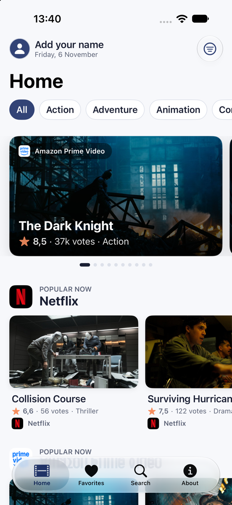
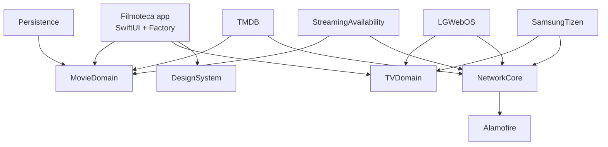

<p align="center">
  
</p>

<h1 align="center">Filmoteca</h1>

<p align="center">
  Descubra filmes, veja onde assistir e abra direto na sua TV.
  <br>
  App iOS gratuito, feito em SwiftUI, construído sobre APIs públicas.
</p>

<p align="center">
  
  
  
  
</p>

<p align="center">
  
</p>

---

## ✨ Recursos

- **Início**: um carrossel de destaques e prateleiras por serviço de streaming (Netflix, Prime Video…).
  - Ordenação por **Em alta** (popularidade dos últimos dias) ou **Mais votados** (total de votos).
  - Quantidade máxima de filmes: 5, 10, 15 ou 20.
  - Filtro por **gênero** num carrossel logo abaixo do título.
- **Detalhes do filme**: sinopse, elenco, trailer, onde assistir e títulos relacionados.
- **Favoritos**: ficam salvos no aparelho (SwiftData), com o mesmo filtro por gênero.
- **Busca**: resultados com rolagem infinita e filtro por gênero.
- **Assistir na TV**: abre o filme no app de streaming da sua TV **Samsung** ou **LG**, pela rede local.
- **Perfil local**: foto e nome escolhidos por você, com o dia atual, no topo da Início.
- **Sobre**: explica as notas, as APIs e as limitações das TVs.
- Interface em **português (Brasil)** e **inglês**, com modo claro e escuro.

## ⭐ Como funcionam as notas

As notas vêm da comunidade do [TMDB](https://www.themoviedb.org). Cada usuário dá de 0,5 a 10, e o app mostra a **média de todos os votos** que o filme já recebeu. Não é uma média diária nem semanal. Ao lado aparece a quantidade de votos, que mostra o quanto a nota é confiável.

| Critério | Endpoint / ordenação | O que significa |
| --- | --- | --- |
| Em alta | `popularity.desc` | Interesse recente: visitas, votos e listas dos últimos dias. Muda diariamente. |
| Mais votados | `vote_count.desc` | Maior número de votos acumulados. Favorece clássicos e títulos conhecidos. |

> O Filmoteca **apenas exibe** esses dados: não é possível votar pelo app.

## 🧰 Requisitos

- Xcode 26 ou mais novo (alguns recursos visuais usam APIs do iOS 26, com alternativa para versões anteriores)
- iOS 17 ou mais novo
- Chaves pessoais e gratuitas do **TMDB** e do **Streaming Availability** (Movie of the Night)

## 🚀 Começando

### 1. Gere as suas chaves de API

O app não vem com chaves. Cada pessoa gera as suas:

| Serviço | Para que serve | Onde gerar |
| --- | --- | --- |
| TMDB | Filmes, notas, gêneros, imagens e onde cada título está disponível | [themoviedb.org/settings/api](https://www.themoviedb.org/settings/api) |
| Streaming Availability (Movie of the Night) | Ofertas e links dos títulos nos serviços de streaming, usados para abrir na TV | [movieofthenight.com/about/api](https://www.movieofthenight.com/about/api) |

No TMDB, tanto a **API Key (v3)** quanto o **token de leitura (v4)** funcionam: o app reconhece o token pelo prefixo `eyJ` e o envia como `Authorization: Bearer`.

### 2. Configure os segredos

```bash
cp Filmoteca/Configuration/Secrets.example.xcconfig Filmoteca/Configuration/Secrets.xcconfig
```

Preencha o `Secrets.xcconfig`:

```xcconfig
TMDB_DEBUG_URL=https:/$()/api.themoviedb.org/3
TMDB_DEBUG_KEY=sua_chave_do_tmdb

TMDB_STAGING_URL=https:/$()/api.themoviedb.org/3
TMDB_STAGING_KEY=sua_chave_do_tmdb

TMDB_RELEASE_URL=https:/$()/api.themoviedb.org/3
TMDB_RELEASE_KEY=sua_chave_do_tmdb

MOTN_DEBUG_URL=https:/$()/api.movieofthenight.com/v4
MOTN_DEBUG_KEY=sua_chave_do_movie_of_the_night

MOTN_STAGING_URL=https:/$()/api.movieofthenight.com/v4
MOTN_STAGING_KEY=sua_chave_do_movie_of_the_night

MOTN_RELEASE_URL=https:/$()/api.movieofthenight.com/v4
MOTN_RELEASE_KEY=sua_chave_do_movie_of_the_night
```

> [!NOTE]
> O `$()` em `https:/$()/` é proposital. Num `.xcconfig`, `//` inicia um comentário, e o `$()` vazio evita que a URL seja cortada.

> [!IMPORTANT]
> O `Secrets.xcconfig` está no `.gitignore`. Nunca faça commit das suas chaves.

### 3. Rode

Abra `Filmoteca.xcodeproj`, escolha o esquema **Filmoteca** e um simulador ou iPhone, e rode com ⌘R.

Os ambientes **Debug**, **Staging** e **Release** têm cada um o seu `.xcconfig` e leem as chaves correspondentes do `Secrets.xcconfig`.

## 🏗️ Arquitetura

O app é dividido em pacotes Swift locais. **Domínio** define modelos e protocolos; **provedores** implementam esses protocolos; o **app** só conhece os protocolos e recebe as implementações por injeção de dependência ([Factory](https://github.com/hmlongco/Factory)).



| Pacote | Responsabilidade |
| --- | --- |
| `MovieDomain` | Modelos (`Movie`, `Genre`, `WatchProvider`…) e protocolos (`DiscoverMovies`, `SearchMovies`…). Só depende da Foundation. |
| `TVDomain` | Modelos e protocolos para parear uma TV e abrir conteúdo nela. Guarda o pareamento no Keychain. |
| `NetworkCore` | Camada de rede genérica (HTTP e WebSocket), sem conhecer nenhuma API. |
| `TMDB` | Implementação de `MovieDomain` com a API do TMDB. |
| `StreamingAvailability` | Ofertas de streaming e links por título, com a API Streaming Availability (Movie of the Night). O plano gratuito permite 1.000 consultas por mês. |
| `Persistence` | Favoritos com SwiftData. |
| `LGWebOS` | Controle de TVs LG pelo protocolo SSAP (WebSocket). |
| `SamsungTizen` | Controle de TVs Samsung pela API de controle remoto (WebSocket + HTTP). |
| `DesignSystem` | Tokens (cores, fontes, espaçamentos, raios, movimento) e componentes (`DSButton`, `DSCard`, `DSTextField`). |

Trocar de provedor é mudar uma linha em `Filmoteca/DependencyInjection/Container+Movies.swift`:

```swift
var listMovies: Factory<any ListMovies> {
    self { self.tmdbMovieRepository() } // troque por outro repositório ou um mock
}
```

### Estrutura do app

```
Filmoteca/
├── Configuration/          # xcconfigs, Info.plist, Assets e catálogos de strings
├── DependencyInjection/    # Registros do Factory por área (rede, filmes, TV…)
├── Features/TMDB/
│   ├── Home/               # Carrossel, prateleiras e filtros
│   ├── Detail/             # Detalhes do filme
│   ├── Favorites/
│   ├── Search/
│   ├── WatchOnTV/          # Folha "Assistir na TV"
│   ├── Profile/            # Perfil local (foto e nome)
│   ├── About/
│   ├── Components/         # Cards, prateleiras, carrossel de gêneros…
│   └── Support/            # Formatação e catálogo de gêneros
├── MyApp.swift
└── SplashView.swift
```

## 📺 Assistir na TV

Funciona apenas com TVs **Samsung (Tizen)** e **LG (webOS)** na mesma rede Wi-Fi do iPhone. No primeiro uso, a TV pede, na própria tela, autorização para o pareamento.

Os protocolos usados são os de controle remoto que as TVs oferecem na rede local. **Não são APIs oficiais** para apps de terceiros, então o resultado varia:

- alguns modelos não informam os apps instalados;
- alguns ignoram o pedido de abrir um app, ou não confirmam que ele abriu;
- abrir direto no título depende do serviço de streaming. Quando não é possível, o app do serviço abre na tela inicial.

Essas limitações têm motivos comerciais (os serviços controlam quem pode abrir os seus apps) e de segurança (os fabricantes restringem o que outros aparelhos da rede podem fazer, e os modelos mais novos só aceitam conexões criptografadas).

## 🧪 Testes

Cada pacote tem os seus testes:

```bash
cd Packages/TMDB && swift test
```

Pacotes com testes: `DesignSystem`, `TMDB`, `StreamingAvailability`, `Persistence`, `TVDomain`, `LGWebOS` e `SamsungTizen`. Os testes de TV usam TVs falsas (`FakeTV`, `FakeSamsungTV`), sem precisar de uma TV de verdade.

## 🔒 Privacidade

Favoritos, TVs pareadas e o perfil ficam **só no aparelho**. O app não tem servidor próprio nem conta: as consultas vão direto para o TMDB e o Streaming Availability, e os comandos vão direto para a TV pela rede local.

## 🙏 Créditos

Este produto usa a API do TMDB, mas não é endossado nem certificado pelo TMDB.
Os dados de onde assistir do TMDB (serviços em que cada filme está disponível) são fornecidos pela [JustWatch](https://www.justwatch.com).
Disponibilidade e links de streaming fornecidos pela [Streaming Availability API](https://www.movieofthenight.com/about/api), do Movie of the Night.
